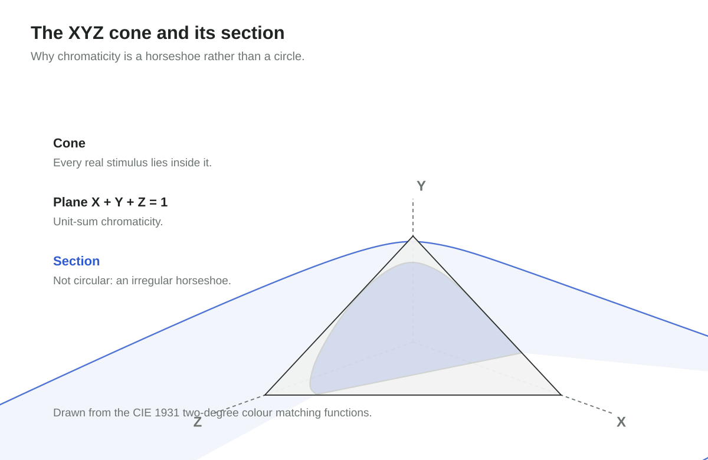

<!-- cspell:ignore aerosol chromaticity CIECAM CIELAB Guild irradiance metamerism OKLab OKLCH photopic psychophysics Rayleigh reflectance Sentinel sRGB trichromacy -->

The visible spectrum is a line: roughly 380 to 700 nanometres, ordered by
wavelength. Every colour wheel, though, puts red and violet next to each other,
with magenta between them. Magenta has no wavelength at all.

The wheel is not a picture of light. It is a picture of the observer. Combining
the two ends of the spectrum produces a colour the spectrum never contains,
because the visual system does not resolve wavelength — it compares three
broad, overlapping receptor responses, and both ends of the spectrum drive the
same two of them. In that comparison, the line closes.

## Three receptors, one lossy compression

Sunlight contains a continuum of wavelengths at continuously varying power. The
retina samples that continuum with three cone types — long, medium, and short
wavelength sensitive, usually written L, M, S — whose response bands overlap
heavily.

The visual system reports a triple, not a spectrum. Different spectra that
produce the same triple are indistinguishable under the same viewing
conditions. That is metamerism, and it is the load-bearing fact of the entire
field: colour is a many-to-one, lossy encoding of light.

Two consequences follow, and they are worth keeping apart:

1. **A reproduction does not need to match a spectrum, only a response
   triple.** This is why a display with three light-emitting channels can show
   a scene it never measured, and why the compression is useful rather than
   merely lossy.
2. **The compression is not invertible.** No amount of colour data recovers the
   original spectrum. A spectrometer measures the input; a colorimeter measures
   the output of the compression. Colour engineering lives in the translation
   between the two.

The first consequence is a permission, the second is a limit. Most arguments
about colour come from confusing them.

## The measurement problem of 1931

By the late 1920s, electric lighting, photography, printing, and dyed textiles
shared one problem: no portable, device-independent way to state a colour. Each
industry had instruments; none had a common language.

| Year      | Step                                                                                      |
| --------- | ----------------------------------------------------------------------------------------- |
| 1900      | The Commission Internationale de Photométrie is founded to coordinate photometric work    |
| 1913      | It becomes the Commission Internationale de l'Éclairage (CIE)                             |
| 1924      | The CIE adopts V(λ), the photopic luminous efficiency function                            |
| 1928–1930 | W. D. Wright in London and John Guild at the National Physical Laboratory run experiments |
| 1931      | The CIE publishes the standard observer and the XYZ system                                |

The experiment is a null measurement. An observer sees a test stimulus beside a
mixture of three primaries and adjusts the primaries until the two fields look
identical. Nothing is read off an instrument; the observer reports equality,
repeatedly, under controlled adaptation and over a small central field — 2° of
visual angle, roughly a thumbnail at arm's length.

Wright used ten observers and narrow-band primaries near 630, 530, and 460 nm.
Guild used seven observers, filtered primaries, and a tungsten source.
Seventeen people in total. The 1931 standard observer is their average,
tabulated as colour matching functions x̄(λ), ȳ(λ), and z̄(λ) at 5 nm intervals.

"Seventeen" is the experimental sample, not the research headcount. The standard
is one layer in a stack, and every layer asks a different question:

| Layer     | Question                                 | Discipline         |
| --------- | ---------------------------------------- | ------------------ |
| Stimulus  | What light reaches the eye?              | Optics, photometry |
| Receptor  | How is that light sampled?               | Visual physiology  |
| Judgment  | When do two stimuli look equal?          | Psychophysics      |
| Transform | What invariant summarises the judgments? | Mathematics        |
| Interface | What can everyone else build on?         | Standardisation    |

No layer can produce the standard alone. Physics cannot say when two different
spectra look identical; introspection cannot produce a reproducible number; a
committee cannot measure. The standard exists because each discipline owned one
question and handed a result to the next.

## Why not simply use RGB

Real primaries make poor coordinates. Matching some monochromatic lights
requires a negative coefficient, which is physically meaningful in the
laboratory — light is added to the comparison field instead of the test field —
but unhelpful as a public coordinate system. Both Wright's and Guild's data
contain negative values.

So the CIE performed a linear change of basis: three virtual primaries, placed
outside the spectral locus, chosen so that every physically realisable stimulus
has non-negative XYZ, and so that Y carries luminance, tying the system to the
1924 V(λ) function.

This is the point that is easiest to miss. XYZ adds no data and no physics. It
is the same measurements expressed in a basis where the constraint holds and
where one axis already means something people use. The hard work — the
experiment, the observers, the averaging — happened before the algebra.

## From a cone to a map

XYZ is a cone in three dimensions: not a circle, and not a cone with a circular
cross-section. The plane X + Y + Z = 1 cuts it in an irregular horseshoe,
because the virtual primaries are not equally spaced in perception.

Normalising gives chromaticity coordinates `x = X / (X + Y + Z)` and
`y = Y / (X + Y + Z)`.

That is a projection along rays from the origin onto the plane X + Y + Z = 1,
not a vertical drop that discards Z. Both x and y depend on all three values;
what disappears is brightness, not the third coordinate.

The curved edge of the horseshoe is the spectral locus, the monochromatic
lights. The straight edge joins its two ends: mixtures, not wavelengths. Inside
lies every colour a human observer can match. A gamut is a triangle in that
plane, and the triangles differ only in which primaries were chosen.

Two readings of that diagram deserve care. "99% of P3" is a statement about P3,
not about human vision: the horseshoe contains colours that no three-primary
display can reach. And the diagram's area is not perceptually uniform — equal
distances on the page are not equal differences in appearance. Both are
properties of the map, not of the standard's accuracy.

## What the standard does not claim

The 1931 observer is not a complete theory of colour, and it does not pretend to
be.

- **Not perceptually uniform.** A step of the same size in xy is not a step of
  the same perceived size. CIELAB (1976), and later OKLab and OKLCH (2020), are
  explicit attempts to fix this; they are derived from the 1931 data and remain
  anchored to it.
- **Not a full appearance model.** Colour appearance shifts with surround,
  adaptation state, luminance, and stimulus size. CIECAM02 and its successor
  CAM16 model those shifts; the standard observer is the reference condition
  they build on.
- **Not an explanation of colour experience.** It fixes the conditions under
  which observers can be compared, which is a different and much smaller claim.

| Claim                                               | Supported by the 1931 standard      |
| --------------------------------------------------- | ----------------------------------- |
| Two defined stimuli match for a standard observer   | Yes, under the specified conditions |
| Two colours differ by a given perceptual amount     | No — needs a uniform space          |
| A colour will look the same in a different surround | No — needs an appearance model      |
| What it is like to see that colour                  | No                                  |

## Rebuilding a photograph from thirteen bands

A satellite does not photograph colour. The Sentinel-2 imager records thirteen
bands: thirteen filtered detectors, each returning one number per pixel, the
scene's radiance integrated against that filter's response, across wavelengths
from 443 nm in the blue to 2202 nm in the short-wave infrared. None of those
numbers is red, green, or blue, and nine of them have no counterpart in human
vision at all.

Something downstream has to turn thirteen integrals into three. The first step
is physical. Digital numbers become reflectance by dividing out the band's solar
irradiance and the cosine of the solar zenith angle, so the same surface reads
the same at noon and at the edge of the orbit. The atmosphere is then removed:
path radiance, aerosol scattering, and Rayleigh scattering that grows as the
inverse fourth power of wavelength and is roughly nine times stronger at 400 nm
than at 700 nm. Skip that step and a blue channel built from B2 is mostly sky.

The second step is the one this article has been describing. Nine of the bands
have to be resolved into XYZ. There is no unique way to do it — a spectrum is
not recoverable from nine broad integrals, so the compression stays lossy — and
the conversion is a 3 × 13 matrix fitted so that a set of representative spectra
under a known illuminant reproduces the XYZ the standard observer would have
recorded. Fit against a library of measured reflectances and the answer depends
on the library; fit against the sensor's own response functions and it depends
on the assumption. Neither is a measurement.

From XYZ onward, the pipeline is arithmetic every display already implements:
the sRGB matrix, gamut clipping, the transfer function. Then an editorial
decision called a tone curve, because reflectance spans more range than eight
bits can hold, so some step has to decide what counts as white. Two pipelines
can both be correct about the standard and produce visibly different pictures.

What is worth noticing is how little of the instrument reaches the screen. Three
bands of thirteen become a natural-colour image; the red-edge and infrared bands
are discarded for display and kept for everything else — vegetation indices,
water quality, crop stress. A false-colour composite sends the near-infrared
band into the red channel instead, deliberately abandoning appearance so that a
difference becomes visible. That is the second consequence from the top of this
article, used on purpose: since the compression is not invertible, the remaining
channels are spent on discrimination rather than on looking right.

Almost every step is a choice: the atmosphere model, the libraries the matrix is
fitted against, the gamut policy, the tone curve. Each has a literature of
disagreement behind it. The one that is not a choice is the definition of XYZ
and of the observer it refers to, and it is also the one nobody renegotiates
when the instrument changes. A satellite is temporary by design. The observer it
is calibrated against has now outlived four generations of detector.

## The transferable design decision

The standard's durability comes from the size of the abstraction, not the
precision of the experiment. The 1931 observer is known to be imperfect: the
1964 supplementary observer widened the field to 10°, cone fundamentals were
later derived from the data, and V(λ) is still debated at the blue end.

None of that retired the interface. And the interface could have been something
else. The committee might have standardised an instrument, a chart, a pigment
set, or a viewing booth — all concrete, all useful, and all dated within a
decade. It standardised a function instead: three curves and a transform, from
which instruments, charts, and gamut diagrams could be derived by anyone.

That is the test worth applying to an internal boundary. Not "will this still be
true in ten years?" — it probably will not. The question is whether the things
built on top can still be expressed when the facts underneath change. A colour
matching function sits _below_ displays, sensors, and colour spaces, so any of
them can be replaced without renegotiating the standard.

The same reasoning explains the awkward-looking parts: virtual primaries nobody
can manufacture, non-negative coordinates, Y conscripted to carry luminance.
Each was a deliberate concession to make the interface usable from above. A
simple interface downstream usually means the complexity was absorbed upstream,
on purpose.

## Ninety-five years on

Every phone screen, camera pipeline, print profile, and HDR master still speaks
XYZ. Cameras and satellite sensors may capture four, a dozen, or hundreds of
bands and never need XYZ internally — but the moment they must present a colour
a person can judge, the common language is worth its cost.

Meanwhile, CIELAB, OKLab, and OKLCH keep improving the perceptual side of the
problem, particularly for interface design and scientific visualisation, where a
numerical distance should track a visual one.

## On the figures

The diagrams are explanatory illustrations made for this post, but the curves
and the horseshoe are not sketched by hand: every spectral locus point, cone
response, and chromaticity colour is computed from the CIE 1931 two-degree
colour matching functions tabulated at one-nanometre intervals (360–830 nm).
Cone responses are reconstructed from those functions through the
Hunt–Pointer–Estévez transform, so the figure shows the standard's own numbers
rather than an idealised model. The chromaticity field is a rendering of those
coordinates in sRGB, which cannot show the full horseshoe at full saturation, so
treat the colours as indicative and the coordinates as exact. The satellite
passbands follow the published Sentinel-2A MSI specification, rounded to whole
nanometres, and the observer curves beside them are the same tabulated
functions. Historical statements follow the CIE's own account of the standard
and the early Wright and Guild papers.

## Endnote: from the physical world to experience

The history invites a Kantian reading — the spectrum as it is in itself, the
perceived colour as it appears to us — with one correction. Electromagnetic
radiation is a measurable scientific object, not a thing-in-itself in Kant's
strict sense, so the two distinctions do not coincide.

What the CIE actually built is narrower and more useful: a verifiable loop from
controlled spectral input to a publicly comparable matching report. "End to end"
here means the loop closes and can be repeated, not that anyone has explained
how a brain produces experience. Objectivity, on this reading, is not the
exclusion of the observer. It is the strict specification of the conditions
under which observers can be compared.
