<!-- cspell:ignore aerosol chromaticity CIECAM CIELAB deuteranomaly deuteranopia dichromats Guild irradiance metamerism OKLab OKLCH opsin photopic psychophysics Rayleigh reflectance rhodopsin Sentinel sRGB tetrachromacy trichromacy trichromats -->

Point a phone at a green wall, then send the photograph to a screen on another
continent. The wall is still green. Nothing that travelled between the two
devices contained a colour: the file is a grid of three integers per pixel, the
screen is a grid of three small lamps, and the two machines were designed by
different companies, decades apart, out of different materials. They agree
anyway, and almost nobody notices that they had to agree in advance.

That agreement is what this article is about. It is a convention, one of the
oldest still running inside your pocket, and it was written down in 1931 by a
committee working with seventeen people's eyes. Getting there needs three
questions answered in order: what light is, how the eye samples it, and what
everybody decided to write down.

## A line that closes into a circle

Visible light is an electromagnetic wave, and for colour purposes the only
property that matters is its wavelength: about 380 nanometres at the violet end,
about 700 at the red end. Put those wavelengths in order and you get a line.

Every colour wheel in every design tool, though, puts red and violet next to
each other and fills the gap with magenta. Magenta is not on the line. There is
no wavelength that looks magenta.

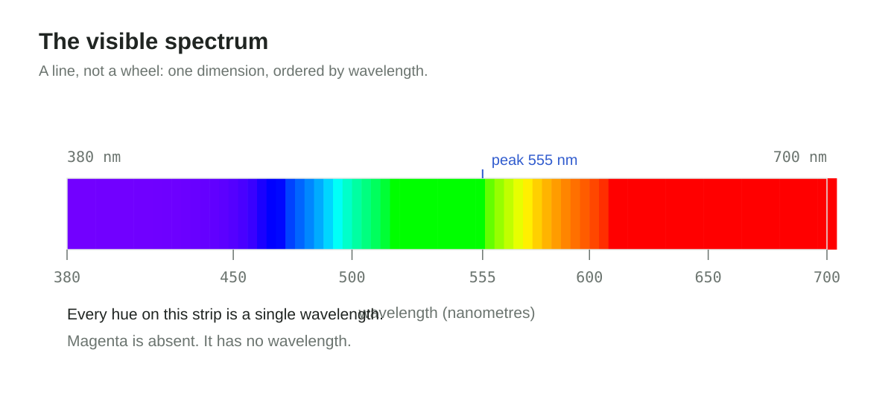

The wheel is not a picture of light; it is a picture of the observer. Combining
the two ends of the spectrum produces a colour the spectrum never contains,
because the eye does not report wavelength at all. It reports three numbers, and
both ends of the line happen to push the same two of those numbers up. In that
report, the line closes into a cycle.

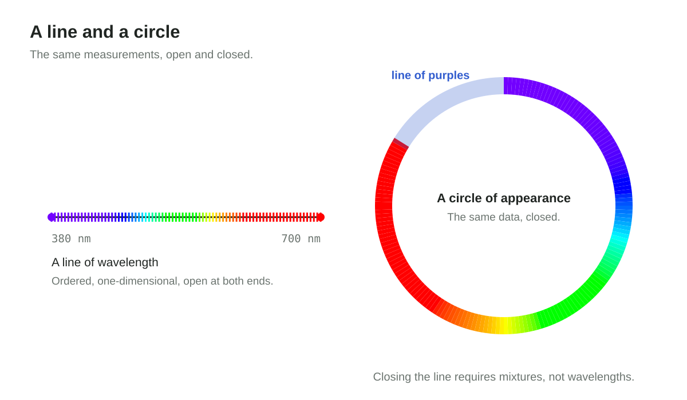

## What the eye actually measures

Sunlight contains a continuum of wavelengths at continuously varying power. The
retina samples that continuum with three kinds of cone — cells named for the part
of the spectrum they respond to best: long, medium and short wavelength
sensitive, written L, M and S. Each kind responds over a broad band, and the
bands overlap heavily, so a wavelength near 550 nm excites all three at once.

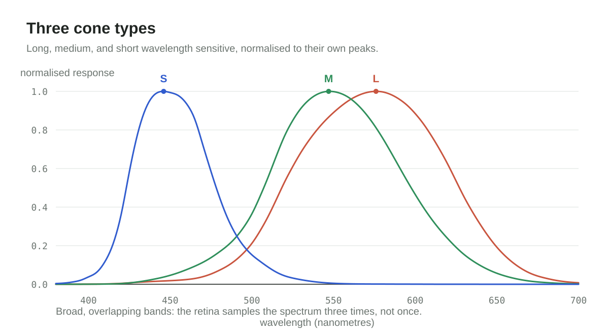

The visual system therefore reports three numbers per point, not a spectrum. Two
different spectra that produce the same three numbers are indistinguishable
under the same viewing conditions. This is metamerism, and it is the fact the
whole field rests on: colour is a many-to-one, lossy encoding of light.

It shows up in ordinary life once you look for it. A screen makes yellow from
red and green light; a printer makes the same yellow from overlapping dots of
ink; a ripe lemon makes it from a narrow band of wavelengths with almost nothing
else present. Three different spectra, one reported triple, one word. The yellow
on the screen is not a worse copy of the yellow of the lemon — as far as your eye
is concerned, it is the same yellow.

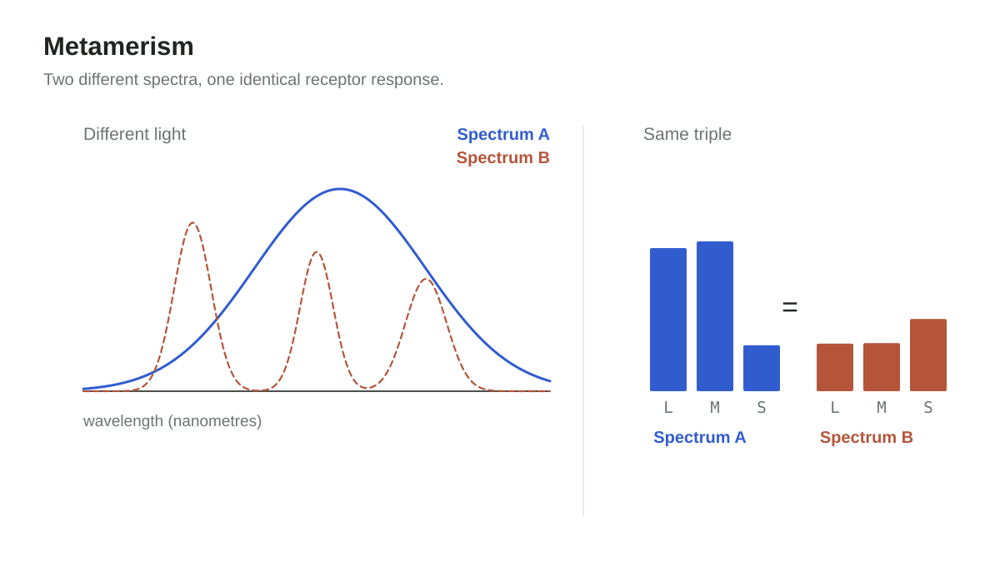

Two consequences follow, and they are worth keeping apart:

1. **A copy does not have to match the light, only the report.** This is why
   three lamps can stand in for a sunset, and why the compression is useful
   rather than merely lossy.
2. **The report cannot be undone.** No amount of colour data recovers the
   original spectrum. A spectrometer measures the light going in; a colorimeter
   measures what came out of the compression. Colour engineering lives in the
   translation between the two.

The first is a permission and the second is a limit. Most arguments about colour
come from confusing the two.

## Where the eye is sensitive

Three curves do not make three equal channels, and the differences matter more
than the similarities. It helps to keep three claims apart that are usually said
in one breath: how bright a wavelength looks, how well the eye separates
neighbouring wavelengths, and how much fine detail it can resolve.

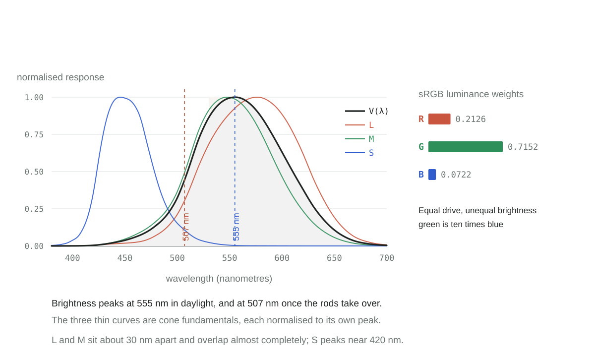

**Brightness is not power.** A wavelength of 555 nm, in the yellow-green, looks
brighter than any other at the same physical power. The 1924 curve V(λ) in the
figure is exactly that measurement, and it is why the standard's Y axis is tied
to it. Every video standard inherits the consequence: the luma used by sRGB and
Rec. 709 is `0.2126 R + 0.7152 G + 0.0722 B`, so green carries 72 per cent of the
brightness of white and blue carries 7. Drive the three channels to the same
level and the green one is ten times as bright as the blue. Nobody chose that
ratio for aesthetic reasons; it fell out of the cone curves. It is why a green
laser pointer looks alarming while a blue one of the same power looks dim, and
why designers are told not to set body text in blue.

**After dark the peak moves.** Rods take over at low light and the eye's
sensitivity slides down to about 507 nm, which is called the Purkinje shift. A
red poppy is the brightest thing in a garden at noon and nearly black at dusk,
while blue flowers gain relative brightness. The rod pigment itself peaks nearer
498 nm; the extra 9 nanometres are the lens, which absorbs short wavelengths
before they ever reach the retina.

**Detail travels on brightness, not on colour.** The eye resolves fine patterns
almost entirely through luminance, and its acuity for colour is several times
coarser. That is why every image and video codec stores colour at reduced
resolution — 4:2:0 in a JPEG discards three quarters of the colour samples and
nobody notices. Short wavelengths are also focused slightly in front of the
retina, because the eye's lens bends blue more than red, so blue edges are never
quite sharp. S cones are another problem: they are only about 5 to 10 per cent
of the cone population and are missing from the very centre of the fovea. Blue is
a poor carrier of information, which is why interface guidance keeps body text
away from it.

**And yet green is where the map is most detailed.** In 1942 David MacAdam had
observers judge just-noticeable differences around the chromaticity diagram and
drew ellipses: equal steps in appearance, unequal in x and y. The smallest sit in
the green and yellow-green, the largest in the blue-violet corner. Near green the
diagram is effectively zoomed in, with far more distinguishable steps per unit
distance. That is one reason a green axis is precise — and it is only half the
story, because _wavelength_ discrimination is at its coarsest in the same place:
L and M rise almost in parallel there, so moving the wavelength a little barely
changes their ratio. The eye is good at telling green mixtures apart and poor at
telling neighbouring greens apart. Both statements are true; they measure
different things.

**Why this arrangement, and why it differs between people.** The vertebrate
ancestor had four cone classes. Mammals passed through a nocturnal bottleneck in
the age of the dinosaurs and lost two of them, which is why dogs, cats, horses
and cattle are dichromats: two cone types, a world built from blue and yellow.
Our own line recovered a third. Somewhere around 30 to 40 million years ago, in
the Old World primates, the gene for the long-wavelength pigment was duplicated
on the X chromosome; the two copies then drifted apart until their peaks sat
about 30 nm apart. That accident is the red-green axis: two pigments so similar
that comparing them yields a sensitive but noisy signal, which the retina
sharpens by wiring them into opponent channels. Why keep it? The leading
hypothesis is food. Ripe fruit and young, red-tinged leaves stand out against a
green canopy precisely in the 530 to 565 nm window where the two pigments differ
most, and the primates that gained the axis ate better. New World monkeys took a
different route, keeping one X-linked gene and varying it, so many females are
trichromats and most males are not; howler monkeys evolved a third cone
independently.

The genetics has a consequence that belongs in any design discussion. The two
opsin genes sit side by side on the X chromosome and can recombine, and males
carry a single X with no second copy to fall back on. About 8 per cent of men of
European ancestry therefore have some red-green deficiency, the commonest form
being a shifted rather than a missing pigment; among women the figure is about
0.5 per cent. Any encoding that puts its distinctions in red-green hue is
unreadable to one man in twelve.

That is the constraint the rest of this article keeps running into. The eye has a
fine axis and a coarse one, and the fine axis is the one a twelfth of men cannot
use.

## 1931: measuring a judgement

By the late 1920s, electric lighting, photography, printing and dyed textiles
shared one problem, and it was a commercial one. A dye works in one city, a
buyer in another, a roll of film in a third: nobody could state a colour in a
form that survived the journey. Each industry had instruments; none had a
language. Two factories could each be right and still produce a mismatch.

| Year      | Step                                                                                      |
| --------- | ----------------------------------------------------------------------------------------- |
| 1900      | The Commission Internationale de Photométrie is founded to coordinate photometric work    |
| 1913      | It becomes the Commission Internationale de l'Éclairage (CIE)                             |
| 1924      | The CIE adopts V(λ), the photopic luminous efficiency function                            |
| 1928–1930 | W. D. Wright in London and John Guild at the National Physical Laboratory run experiments |
| 1931      | The CIE publishes the standard observer and the XYZ system                                |

The experiment is a null measurement, which is the scientists' way of saying
that nothing is measured directly. An observer sees a test light beside a
mixture of three primaries and turns three knobs until the two halves look
identical. Nothing is read off a dial. The observer reports equality, over and
over, under controlled adaptation and over a small central field — 2° of visual
angle, about a thumbnail at arm's length. What gets recorded is not the light; it
is the point at which a person stops being able to tell two lights apart.

Wright used ten observers and narrow-band primaries near 630, 530, and 460 nm.
Guild used seven observers, filtered primaries, and a tungsten source.
Seventeen people in total. The 1931 standard observer is their average,
tabulated as colour matching functions x̄(λ), ȳ(λ), and z̄(λ) at 5 nm intervals.

Seventeen sounds thin for a decision that would outlive everyone in the room, so
it is worth saying why it was enough. The quantity being averaged is a ratio of
primaries, and normal colour vision varies far less between people than the
instruments of the day varied between laboratories. A larger panel would have
moved the numbers slightly without changing their shape — roughly what happened
when the CIE published a supplementary observer in 1964 from a wider sample.

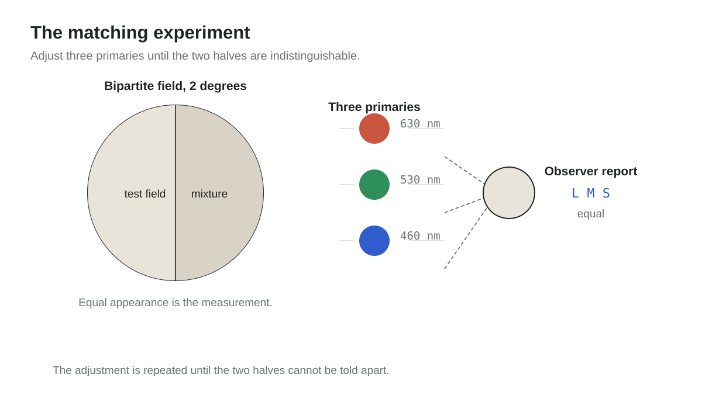

That number is the experimental sample, not the research headcount. The standard
is one layer in a stack, and every layer asks a different question:

| Layer     | Question                                 | Discipline         |
| --------- | ---------------------------------------- | ------------------ |
| Stimulus  | What light reaches the eye?              | Optics, photometry |
| Receptor  | How is that light sampled?               | Visual physiology  |
| Judgment  | When do two stimuli look equal?          | Psychophysics      |
| Transform | What invariant summarises the judgments? | Mathematics        |
| Interface | What can everyone else build on?         | Standardisation    |

No layer can produce the standard alone. Physics cannot say when two different
spectra look identical; introspection cannot produce a reproducible number; a
committee cannot measure. The standard exists because each discipline owned one
question and handed a result to the next.

## Why the obvious answer did not work

Real primaries make poor coordinates. Some saturated colours cannot be matched
at all by adding the three primaries to one side of the comparison: the observer
has to move a primary over to the test side and add it there, so the recorded
coefficient comes out negative. Nothing physical is negative — light was added,
not subtracted — but a shared coordinate system cannot afford the exception.
Both Wright's and Guild's data contain such values.

So the CIE performed a linear change of basis: three virtual primaries, placed
outside the spectral locus, chosen so that every physically realisable stimulus
has non-negative XYZ, and so that Y carries luminance, tying the system to the
1924 V(λ) function.

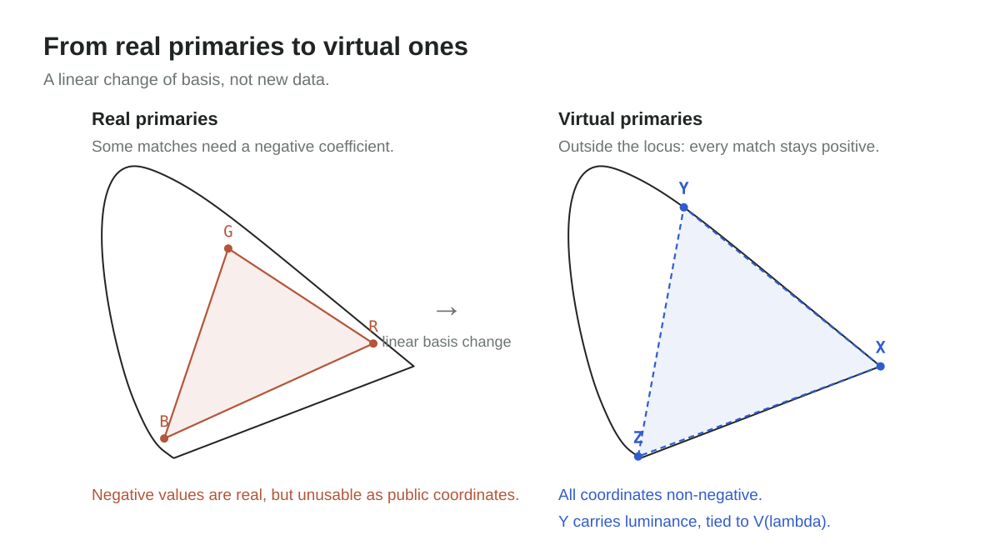

This is the point that is easiest to miss. XYZ adds no data and no physics. It
is the same measurements expressed in a basis where the constraint holds and
where one axis already means something people use. The hard work — the
experiment, the observers, the averaging — happened before the algebra.

## From three numbers to a map

Here is where the geometry turns awkward, and it is worth slowing down. Every
colour the standard observer can describe is a triple (X, Y, Z), so the set of
all of them lives in three dimensions. It forms a cone with the origin at its
tip and the spectral colours along its edge — a cone in the algebraic sense, and
decidedly not a circular one. The plane X + Y + Z = 1 cuts it in an irregular
horseshoe, because the virtual primaries are not equally spaced in perception.

<iframe
  class="viz"
  src="../../../viz/en/"
  title="The XYZ cone, in three dimensions — interactive"
  loading="lazy"
></iframe>

Turn the cone with the pointer, then move the wavelength slider: the ray tilts,
the dot travels along the spectrum, and x and y change with it. Move only the
brightness slider and the dot leaves the plane while x and y stay put, which is
what it means for the projection to discard brightness.

Normalising gives chromaticity coordinates `x = X / (X + Y + Z)` and
`y = Y / (X + Y + Z)`.

That is a projection along rays from the origin onto the plane X + Y + Z = 1,
not a vertical drop that discards Z. Both x and y depend on all three values;
what disappears is brightness, not the third coordinate. Two lights that differ
only in brightness land on the same point, which is the entire purpose of the
move.

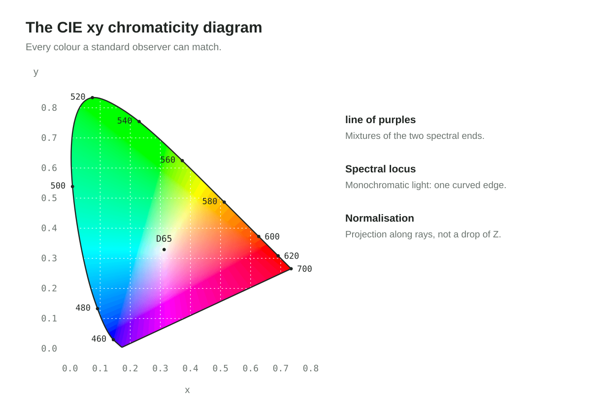

The curved edge of the horseshoe is the spectral locus, the monochromatic
lights. The straight edge joins its two ends: mixtures, not wavelengths. Inside
lies every colour a human observer can match — the whole territory. Any real
display reaches only part of it, and that part is its gamut: on this diagram, a
triangle whose corners are the display's three primaries.

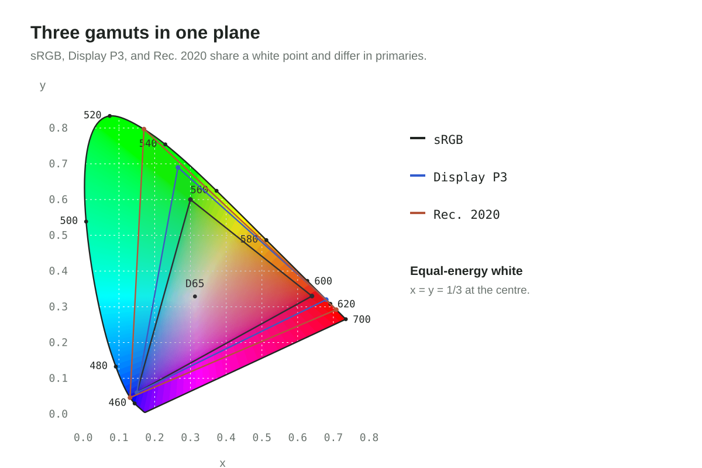

Two readings of that diagram deserve care. "99% of P3" is a statement about P3,
not about human vision: the horseshoe contains colours that no three-primary
display can reach. And the diagram's area is not perceptually uniform — equal
distances on the page are not equal differences in appearance. Both are
properties of the map, not of the standard's accuracy.

## What the standard does not claim

The 1931 observer is not a complete theory of colour, and it does not pretend to
be.

- **Not perceptually uniform.** A step of the same size in xy is not a step of
  the same perceived size. CIELAB (1976), and later OKLab and OKLCH (2020), are
  explicit attempts to fix this; they are derived from the 1931 data and remain
  anchored to it.
- **Not a full appearance model.** Colour appearance shifts with surround,
  adaptation state, luminance, and stimulus size. CIECAM02 and its successor
  CAM16 model those shifts; the standard observer is the reference condition
  they build on.
- **Not an explanation of colour experience.** It fixes the conditions under
  which observers can be compared, which is a different and much smaller claim.

| Claim                                               | Supported by the 1931 standard      |
| --------------------------------------------------- | ----------------------------------- |
| Two defined stimuli match for a standard observer   | Yes, under the specified conditions |
| Two colours differ by a given perceptual amount     | No — needs a uniform space          |
| A colour will look the same in a different surround | No — needs an appearance model      |
| What it is like to see that colour                  | No                                  |

## Rebuilding a photograph from thirteen bands

Everything so far has been about a single point of light. A photograph is a grid
of them, and an imaging satellite multiplies the number of measurements per
point: thirteen instead of three.

A satellite does not photograph colour. The Sentinel-2 imager records thirteen
bands: thirteen filtered detectors, each returning one number per pixel, the
scene's radiance integrated against that filter's response, across wavelengths
from 443 nm in the blue to 2202 nm in the short-wave infrared. None of those
numbers is red, green, or blue, and nine of them have no counterpart in human
vision at all.

Something downstream has to turn thirteen integrals into three. The first step
is physical. Digital numbers become reflectance by dividing out the band's solar
irradiance and the cosine of the solar zenith angle, so the same surface reads
the same at noon and at the edge of the orbit. The atmosphere is then removed:
path radiance, aerosol scattering, and Rayleigh scattering that grows as the
inverse fourth power of wavelength and is roughly nine times stronger at 400 nm
than at 700 nm. Skip that step and a blue channel built from B2 is mostly sky.

The second step is the one this article has been describing. Nine of the bands
have to be resolved into XYZ. There is no unique way to do it — a spectrum is
not recoverable from nine broad integrals, so the compression stays lossy — and
the conversion is a 3 × 13 matrix fitted so that a set of representative spectra
under a known illuminant reproduces the XYZ the standard observer would have
recorded. Fit against a library of measured reflectances and the answer depends
on the library; fit against the sensor's own response functions and it depends
on the assumption. Neither is a measurement.

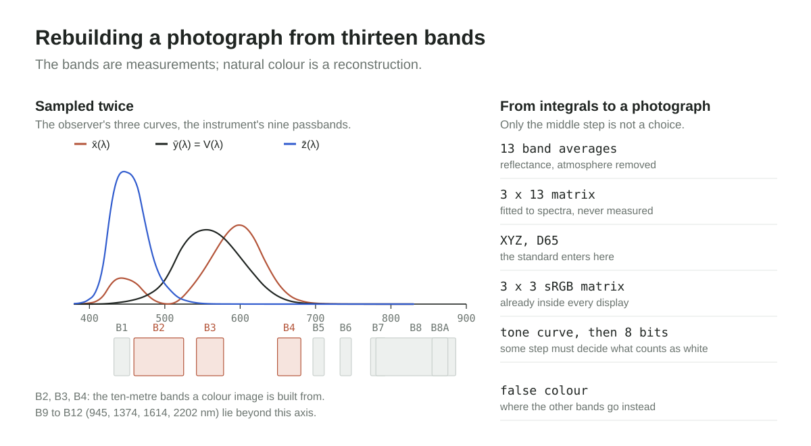

Skip that step and drop three raw band averages straight into red, green and
blue, and you get something faithful to the sensor and useless as a photograph:
the band centres do not sit where the sRGB primaries sit, the white point is
whatever the sun happened to be doing, and the atmosphere is still in the
numbers. It reads like a satellite image left out in the wash. That is the same
failure as an uncalibrated colour ramp, one level earlier — a number promoted to
a colour without a mapping designed for the job.

One thing surprises people who meet this stack for the first time: cameras and
satellites do not use XYZ internally. A sensor emits band values and stays in
band space; demosaicing, white balance and compression all happen on those
numbers. XYZ, and OKLab after it, enter the moment a person has to judge the
result — on a display, in a report, in a colour picker. They are an
interpretation layer, not a processing step, and a pipeline that never shows an
image to anyone never needs them.

From XYZ onward, the pipeline is arithmetic every display already implements:
the sRGB matrix, gamut clipping, the transfer function. Then an editorial
decision called a tone curve, because reflectance spans more range than eight
bits can hold, so some step has to decide what counts as white. Two pipelines
can both be correct about the standard and produce visibly different pictures.

What is worth noticing is how little of the instrument reaches the screen. Three
bands of thirteen become a natural-colour image; the red-edge and infrared bands
are discarded for display and kept for everything else — vegetation indices,
water quality, crop stress. A false-colour composite sends the near-infrared
band into the red channel instead, deliberately abandoning appearance so that a
difference becomes visible. That is the second consequence from the top of this
article, used on purpose: since the compression is not invertible, the remaining
channels are spent on discrimination rather than on looking right.

## Turning a number into a colour

Once the number has stopped being red, green or blue, a second question appears,
and this one has no physics in it at all.

An index such as NDVI is one number per pixel — the normalised difference between
the near-infrared and red bands, a quantity of vegetation rather than a colour.
Turning it into an image means inventing a scale, and the scale is an instrument
in its own right: the reader will judge "more vegetation" by eye, so lightness
has to rise with the index and nothing else may compete with it.

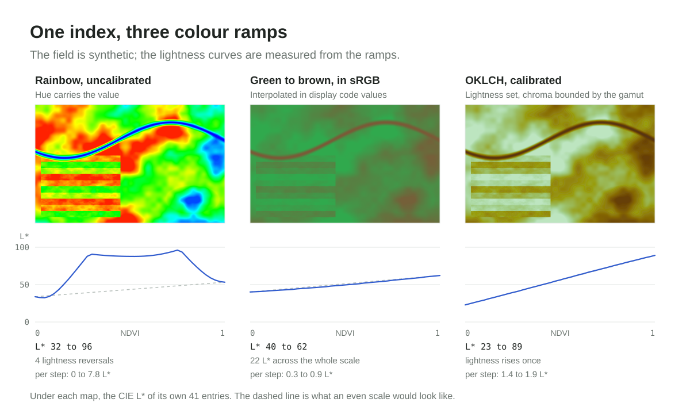

The same field, the same index, three mappings. The rainbow reads well at a
glance and fails on inspection: its CIE lightness reverses four times across the
scale, so a patch can be brighter than one carrying more vegetation, and in
greyscale, or for a reader with deuteranopia, the ordering is gone.
Interpolating green to brown in display sRGB keeps the order but spends 22 of
the 100 lightness units on the whole range, so nearly everything reads as one
mid-tone and the discrimination has to happen in hue alone. The third ramp is
written in OKLCH, the polar form of OKLab: set L, reduce C until each entry fits
inside sRGB, sweep hue from ochre to green. Lightness then moves once, through
66 units, at one or two units per step.

None of that touches the physics. The reflectance, the atmosphere model, the
matrix, and the tone curve are unchanged. The only difference is whether the
last mapping, from number to colour, was designed as a perceptual scale or
inherited as a palette.

This is the sensitivity section arriving on the other side of the article.
Lightness is the axis every reader shares: the reader with a red-green
deficiency, the reader looking at a greyscale print, the reader with the
brightness turned down on a phone in daylight. Hue is the axis that is not
shared. Putting the order into lightness is not a tasteful preference; it is the
only channel that survives every way an image gets copied, printed and resized.

## Almost every step is a choice

Almost every step in that pipeline is a choice: the atmosphere model, the
libraries the matrix is fitted against, the gamut policy, the tone curve, the
ramp that carries an index to the screen. Each has a literature of disagreement
behind it. The step that is not a choice is the definition of XYZ and of the
observer it refers to, and it is also the one nobody renegotiates when the
instrument changes. The satellite is temporary by design. The observer it is
calibrated against has now outlived four generations of detector.

## The transferable design decision

Step back from colour for a moment, because the durable lesson here is about
interfaces rather than about light.

The standard's durability comes from the size of the abstraction, not the
precision of the experiment. The 1931 observer is known to be imperfect: the
1964 supplementary observer widened the field to 10°, cone fundamentals were
later derived from the data, and V(λ) is still debated at the blue end.

None of that retired the interface. And the interface could have been something
else. The committee might have standardised an instrument, a chart, a pigment
set, or a viewing booth — all concrete, all useful, and all dated within a
decade. It standardised a function instead: three curves and a transform, from
which instruments, charts, and gamut diagrams could be derived by anyone.

That is the test worth applying to an internal boundary. Not "will this still be
true in ten years?" — it probably will not. The question is whether the things
built on top can still be expressed when the facts underneath change. A colour
matching function sits _below_ displays, sensors, and colour spaces, so any of
them can be replaced without renegotiating the standard.

The same reasoning explains the awkward-looking parts: virtual primaries nobody
can manufacture, non-negative coordinates, Y conscripted to carry luminance.
Each was a deliberate concession to make the interface usable from above. A
simple interface downstream usually means the complexity was absorbed upstream,
on purpose.

## Ninety-five years on

Every phone screen, camera pipeline, print profile, and HDR master still speaks
XYZ. A sensor may capture four bands or hundreds and never need it internally,
but the moment the result has to be judged by a person, the common language
earns its cost.

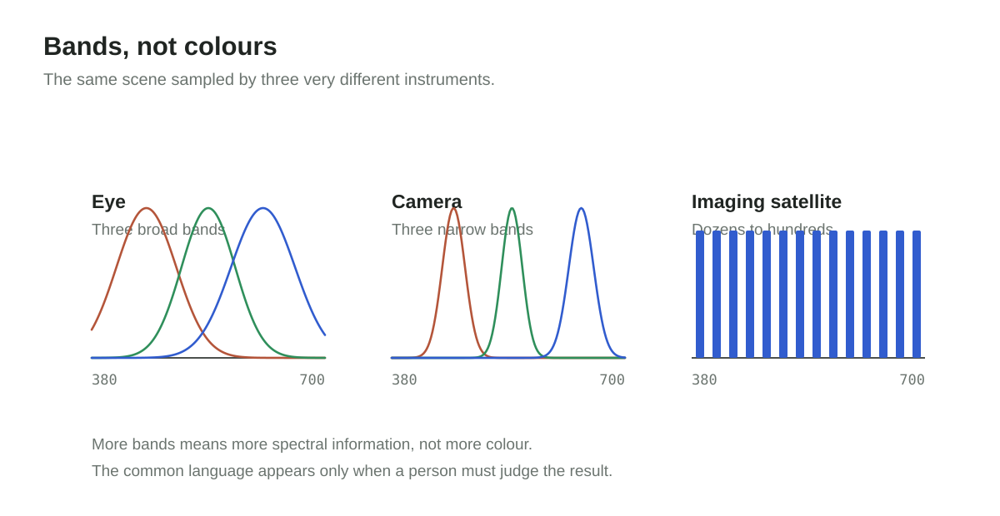

Meanwhile, CIELAB, OKLab, and OKLCH keep improving the perceptual side of the
problem, particularly for interface design and scientific visualisation, where a
numerical distance should track a visual one.

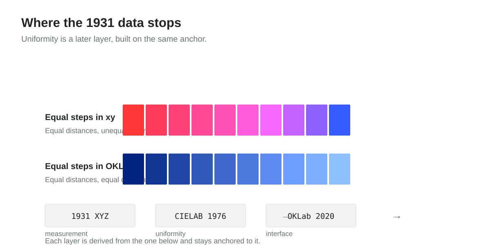

## On the figures

The diagrams are explanatory illustrations made for this post, but the curves
and the horseshoe are not sketched by hand: every spectral locus point, cone
response, and chromaticity colour is computed from the CIE 1931 two-degree
colour matching functions tabulated at one-nanometre intervals (360–830 nm).
Cone responses are reconstructed from those functions through the
Hunt–Pointer–Estévez transform, so the figure shows the standard's own numbers
rather than an idealised model. The sensitivity figure uses that same table end
to end: V(λ) is ȳ(λ) itself, the 555 nm marker sits on the tabulated maximum, and
the three thin curves are the reconstructed fundamentals drawn to their own
peaks. The weights beside them are the published Rec. 709 luma coefficients, and
the 507 nm marker is the CIE 1951 scotopic peak rather than a curve invented
here. The chromaticity field is a rendering of those
coordinates in sRGB, which cannot show the full horseshoe at full saturation, so
treat the colours as indicative and the coordinates as exact. The satellite
passbands follow the published Sentinel-2A MSI specification, rounded to whole
nanometres, and the observer curves beside them are the same tabulated
functions. The colour-ramp comparison compares mappings, not data: the index
field is synthetic, generated with the spread of a mid-season agricultural
scene, while the three ramps and the L\* curves beneath them are computed — HSV
for the rainbow, linear interpolation for the display-RGB pair, and OKLCH
through Björn Ottosson's OKLab matrices with chroma reduced until every entry
fits inside sRGB. Each L\* value is the CIE 1976 lightness of the bytes actually
drawn. Historical statements follow the CIE's own account of the standard
and the early Wright and Guild papers. The interactive cone is computed in the
browser from that same table, committed with the site as
`src/data/ciexyz31_1.csv`, sampled every five nanometres from 380 to 700 nm; it
draws the cone as a slice through the ray space and puts the horseshoe exactly
on the plane X + Y + Z = 1, so moving the brightness slider changes the point's
distance from the origin and nothing about its x and y.

## Endnote: from the physical world to experience

The history invites a Kantian reading — the spectrum as it is in itself, the
perceived colour as it appears to us — with one correction. Electromagnetic
radiation is a measurable scientific object, not a thing-in-itself in Kant's
strict sense, so the two distinctions do not coincide.

What the CIE actually built is narrower and more useful: a verifiable loop from
controlled spectral input to a publicly comparable matching report. "End to end"
here means the loop closes and can be repeated, not that anyone has explained
how a brain produces experience. Objectivity, on this reading, is not the
exclusion of the observer. It is the strict specification of the conditions
under which observers can be compared.
