<!-- cspell:ignore CIELAB MSI OKLab OKLCH Sentinel sRGB -->

可见光谱是一条线：约 380 至 700 纳米，按波长排列。但几乎每个色轮都把红与紫放在一起，中间是品红。品红没有对应的波长。

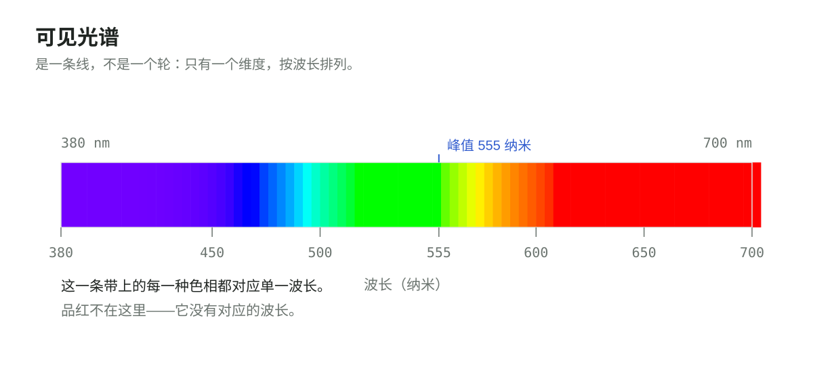

色轮不是光的图像，而是观察者的图像。把光谱的两端混合，会得到光谱里根本不存在的颜色——因为视觉系统并不解析波长，它比较的是三类宽而重叠的受体响应，而光谱两端恰好同时驱动其中的两类。在这个比较里，线闭合成圆。

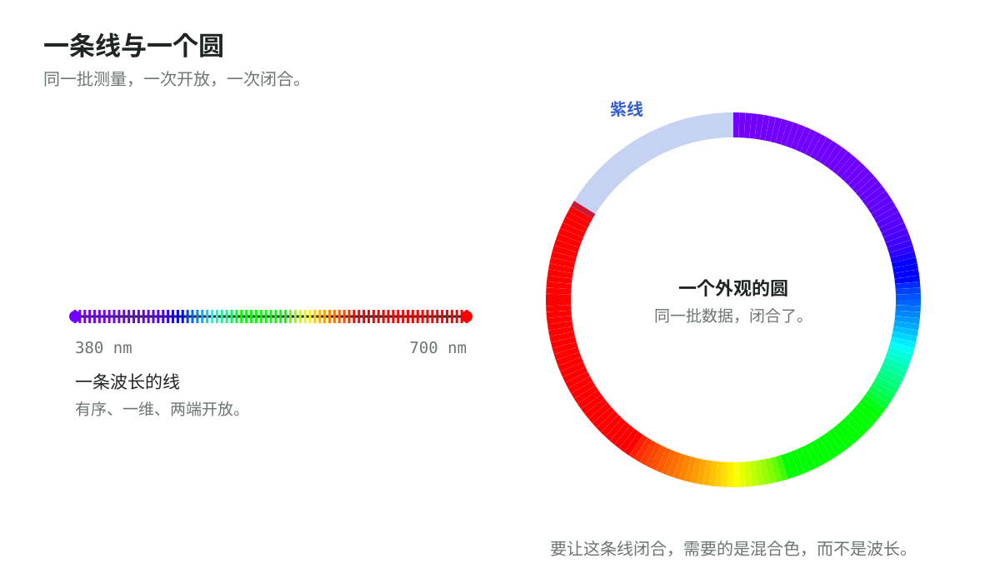

## 三种受体，一次有损压缩

自然光是波长连续、功率连续变化的谱。视网膜用三类视锥细胞对这个连续谱采样：长波、中波、短波敏感，通常记作 L、M、S，响应区间高度重叠。

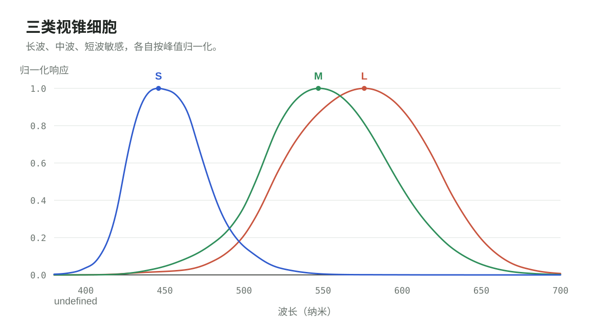

视觉系统输出的是一个三元组，而不是光谱。在相同的观察条件下，能产生同一三元组的不同光谱无法被区分——这就是同色异谱（metamerism）。它是整个领域的承重事实：颜色是光的一次多对一、有损的编码。

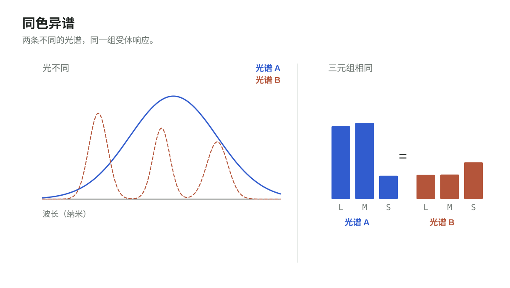

由此有两条推论，值得分开看：

1. **复现不需要还原光谱，只需要复现响应三元组。** 这正是三个发光通道的显示器能呈现它从未测量过的场景的原因，也是这次压缩"有用"而不只是"有损"的原因。
2. **这次压缩不可逆。** 再多的颜色数据也换不回原始光谱。光谱仪测的是输入，色度计测的是压缩之后的输出；颜色工程就活在两者之间的翻译里。

第一条是许可，第二条是限制。多数关于颜色的争论，来自把两者混为一谈。

## 1931 年的测量问题

到 1920 年代末，电光源、摄影、印刷和染料纺织共享同一个问题：没有一种可携带、与设备无关的方式来陈述一种颜色。每个行业都有仪器，但没有共同语言。

| 年份      | 事件                                                                       |
| --------- | -------------------------------------------------------------------------- |
| 1900      | 国际光度委员会（CIP）成立，协调光度测量                                    |
| 1913      | 发展为国际照明委员会（CIE）                                                |
| 1924      | CIE 采用 V(λ)，即明视觉光谱光效率函数                                      |
| 1928–1930 | 伦敦的 W. D. Wright 与英国国家物理实验室的 John Guild 分别进行颜色匹配实验 |
| 1931      | CIE 公布标准观察者与 XYZ 系统                                              |

实验本身是一次零位测量。观察者同时看到测试刺激和三种原色的混合，然后调整原色的比例，直到两个视场看起来完全相同。读数不来自仪器，而来自观察者反复报告的"相等"——在受控的适应状态下，用一个很小的中央视场：2° 视角，大约是一臂之外一片指甲的宽度。

Wright 用了 10 名观察者，原色取 630、530、460 纳米附近的窄带光。Guild 用了 7 名观察者，以滤光片得到原色，光源是钨丝灯。合计 17 人。1931 年的标准观察者就是这 17 人的平均，以 5 纳米间隔的配色函数 x̄(λ)、ȳ(λ)、z̄(λ) 列表公布。

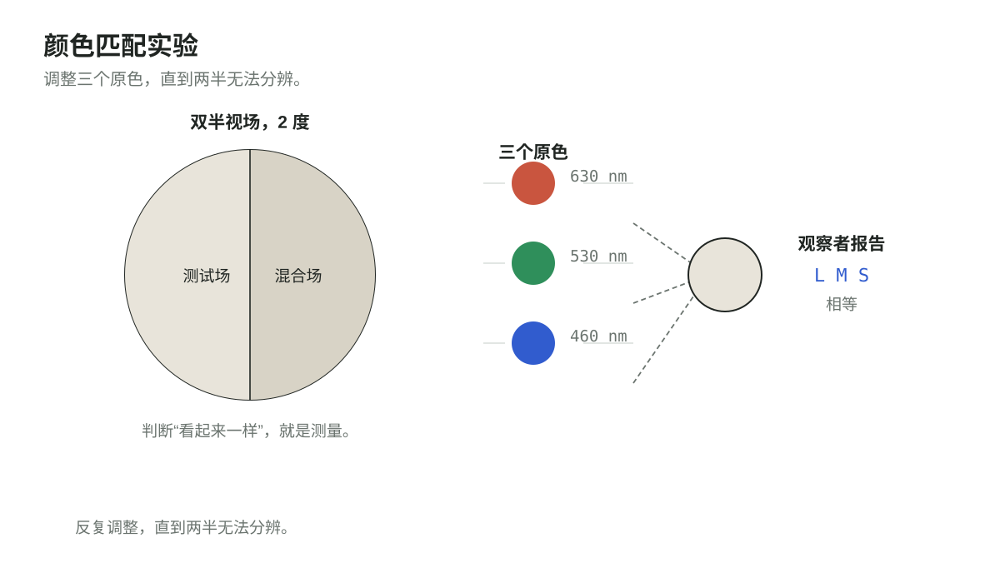

"17" 是实验样本量，不是研究团队的人数。这套标准是分层堆叠中的一层，每一层回答一个不同的问题：

| 层   | 问题                       | 学科         |
| ---- | -------------------------- | ------------ |
| 刺激 | 到达眼睛的是什么光？       | 光学、光度学 |
| 受体 | 这束光如何被采样？         | 视觉生理学   |
| 判断 | 两个刺激何时看起来相同？   | 心理物理学   |
| 变换 | 用什么不变量概括这些判断？ | 数学         |
| 接口 | 其他人可以建立在什么之上？ | 标准化       |

没有哪一层能单独产出这套标准。物理说不出两条光谱何时看起来一样，内省给不出可复现的数字，委员会也无法测量。标准之所以成立，是因为每门学科只负责一个问题，然后把结果交给下一层。

## 为什么不直接用 RGB

真实的原色不适合做坐标。匹配某些单色光时会出现负系数——在实验室里这有明确的物理含义：把光加到比较场，而不是测试场；但作为公开坐标系则很别扭。Wright 和 Guild 的数据里都存在负值。

于是 CIE 做了一次线性基变换：选择三个虚拟原色，落在光谱轨迹之外，使所有物理可实现的刺激都有非负的 XYZ，同时让 Y 承担亮度，与 1924 年的 V(λ) 对齐。

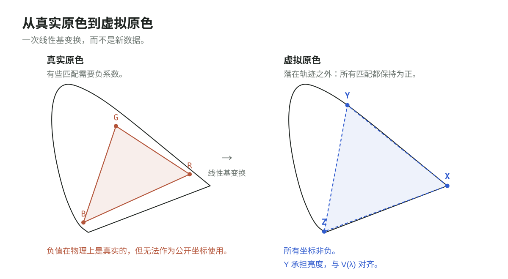

这是最容易被忽略的一点：XYZ 没有增加数据，也没有增加物理。它只是把同一批测量换到一个约束成立、且其中一根轴已经有现成含义的基上。真正困难的工作——实验、观察者、平均——都发生在代数之前。

## 从一个锥到一张图

XYZ 在三维空间里是一个锥：不是圆，截面也不是正圆。X + Y + Z = 1 的平面截出的形状是不规则的马蹄形，因为三个虚拟原色在感知上并不同距。

<iframe
  class="viz"
  src="../../../viz/zh/"
  title="XYZ 颜色锥，三维交互视图"
  loading="lazy"
></iframe>

用指针把锥转过来，再拖动波长滑块：射线随之倾斜，圆点沿光谱移动，x 与 y 跟着改变。只拖亮度滑块时，圆点离开平面，而 x 与 y 不动——这正是"投影消去的是亮度"的意思。

归一化得到色度坐标 `x = X / (X + Y + Z)` 与 `y = Y / (X + Y + Z)`。

这是沿原点射线向 X + Y + Z = 1 平面作投影，不是"丢掉 Z"的垂直投影。x 与 y 都依赖三个值；被消去的是亮度，不是第三个坐标。

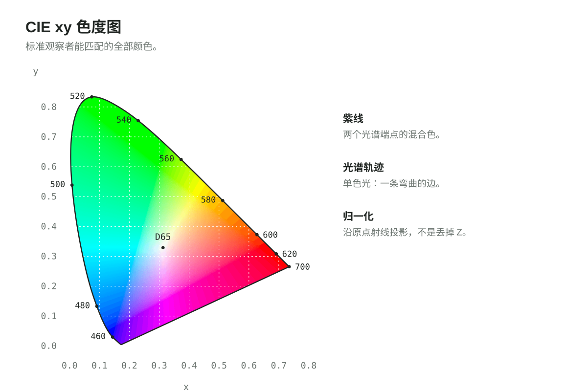

马蹄形的曲边是光谱轨迹，即单色光；直边连接它的两端，代表混合色而非波长。内部覆盖了人类观察者能够匹配的全部颜色。色域是这张平面上的一个三角形，三角形之间的差别只在于选了哪三个原色。

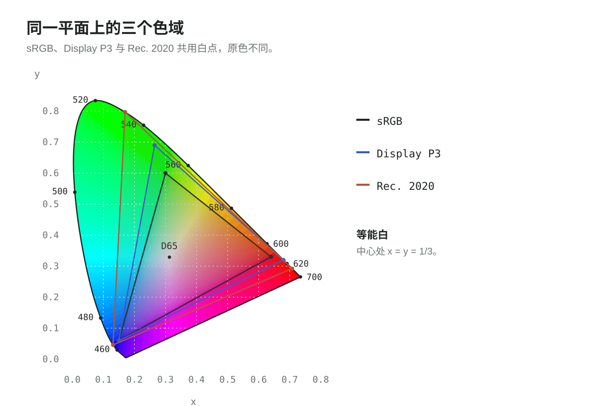

这张图有两种常见误读。"99% P3" 说的是 P3 的覆盖率，不是人眼可见范围：马蹄形里存在任何三原色显示都无法到达的颜色。图中面积也不具备感知均匀性：纸面上相等的距离，不等于观感上相等的差别。这两点都是地图的性质，而不是标准精度的性质。

## 这套标准没有声称的东西

1931 年的观察者不是完整的颜色理论，它也没有这样声称。

- **不是感知均匀空间。** xy 上同样大小的一步，不等于观感上同样大小的一步。CIELAB（1976），以及后来的 OKLab 与 OKLCH（2020），都是针对这一点的显式修正；它们由 1931 的数据导出，并以之为锚。
- **不是完整的外观模型。** 颜色外观会随周围环境、适应状态、亮度和刺激尺寸改变。CIECAM02 及其后继 CAM16 建模的正是这些变化，而标准观察者是它们的参考条件。
- **不解释颜色体验。** 它固定的是观察者之间可以相互比较的条件，这是一个小得多的主张。

| 主张                                 | 1931 标准是否支持        |
| ------------------------------------ | ------------------------ |
| 两个已定义的刺激对标准观察者构成匹配 | 支持，在规定的观察条件下 |
| 两种颜色相差一个给定的感知量         | 不支持，需要均匀空间     |
| 一种颜色在另一种环境中看起来相同     | 不支持，需要外观模型     |
| 看到那种颜色是什么感受               | 不支持                   |

## 从十三个波段重建一张照片

卫星并不"拍摄"颜色。Sentinel-2 的多光谱成像仪记录 13 个波段：13 个带滤光片的探测器，每个探测器对每个像元只给出一个数——场景辐射对该滤光片响应的积分，波长从蓝端的 443 纳米一直延伸到短波红外的 2202 纳米。这些数里没有一个是"红""绿"或"蓝"，其中还有九个在人类视觉中根本没有对应物。

必须有某个环节把 13 个积分变成 3 个。第一步是物理的：用波段自身的太阳辐照度与太阳天顶角的余弦去除，把量化值换算成反射率，于是同一块地表在正午和在轨道边缘测得一致。然后要去掉大气——路径辐射、气溶胶散射，以及按波长四次方反比增长的瑞利散射：400 纳米处比 700 纳米处大约强 9 倍。省掉这一步，用 B2 造出来的蓝通道里大部分是天空。

第二步才是本文一直在讲的那件事：把其中九个波段换算为 XYZ。这件事没有唯一解——从九个宽积分里换不回一条光谱，压缩依然有损；所谓换算，是一个 3 × 13 矩阵：让它把一批代表光谱在已知光源下映射为标准观察者会记录到的 XYZ。用实测反射率库拟合，结果取决于库；用传感器自身的响应函数拟合，结果取决于假设。两者都不是测量。

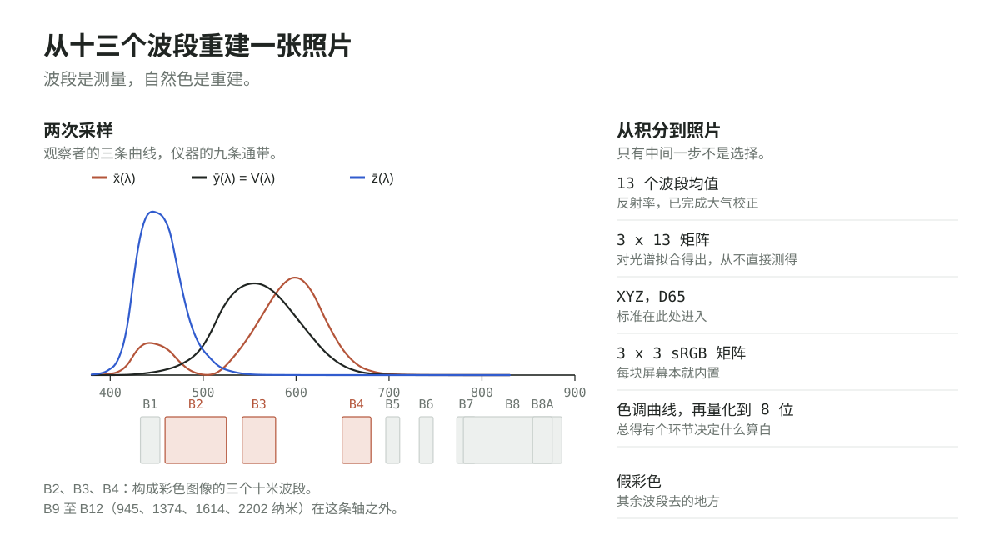

从 XYZ 往后，都是每块屏幕早已实现好的算术：sRGB 矩阵、色域裁剪、传递函数。然后是一处编辑判断，叫色调曲线：反射率的跨度超出 8 位所能容纳的范围，于是必须由某个环节决定"什么算白"。两条管线都可以在标准上完全正确，却给出肉眼可见不同的画面。

值得留意的是，仪器最终有多少东西走到了屏幕上：13 个波段里只有 3 个变成一张真彩图；红边与红外波段被显示所丢弃，却被其他一切所保留——植被指数、水质、作物胁迫。假彩色合成则把近红外波段送进红通道，有意放弃"看起来对"，换取"差别看得见"。这正是本文开头第二条推论的主动应用：既然这次压缩不可逆，剩下的通道就该花在区分上，而不是花在还原上。

几乎每一步都是选择：大气模型、用来拟合矩阵的光谱库、色域策略、色调曲线，每一个背后都有一堆互相不一致的文献。唯一不算选择的，是 XYZ 以及它所指向的那个观察者的定义；而它恰好也是仪器换代时谁都不必重新谈判的那一个。卫星注定是临时的，它所校准的那个观察者，已经送走了四代探测器。

## 一个可以迁移的设计判断

这套标准之所以耐久，靠的是抽象的尺寸，而不是实验的精度。1931 年的观察者已知并不完美：1964 年补充观察者把视场扩大到 10°，锥体基础函数后来由这批数据反推得到，V(λ) 在蓝端至今仍有讨论。

这些都没有让接口退役。而接口本来可以是别的东西。委员会完全可以标准化一台仪器、一张色卡、一套颜料，或者一个观察箱——都很具体，都有用，也都会在十年内过时。它标准化的是一个函数：三条曲线加一次变换，任何人都能从中导出仪器、色卡和色域图。

这也是值得用在内部分界线上的检验。不是"十年后它是否仍然成立"——大概不会。而是"当底下的事实变了，建立在它之上的东西还能不能被表达"。配色函数位于显示器、传感器和色彩空间之下，所以它们中的任何一个都可以被替换，而不必重新协商标准。

同一套推理也解释了那些看起来别扭的部分：没人能制造出来的虚拟原色、非负坐标、被"征用"来表示亮度的 Y。每一处都是为了让上层好用而做的主动让步。下游接口简单，通常意味着复杂度被有意识地在上游吸收了。

## 95 年后

今天每一块手机屏幕、每一条相机管线、每一个印刷配置文件和每一次 HDR 母版制作，仍然在讲 XYZ。相机与卫星传感器可以捕获 4 个、十几个甚至上百个波段，内部完全不需要 XYZ；但当它们必须呈现一个人可以判断的颜色时，这门共同语言就值它的代价。

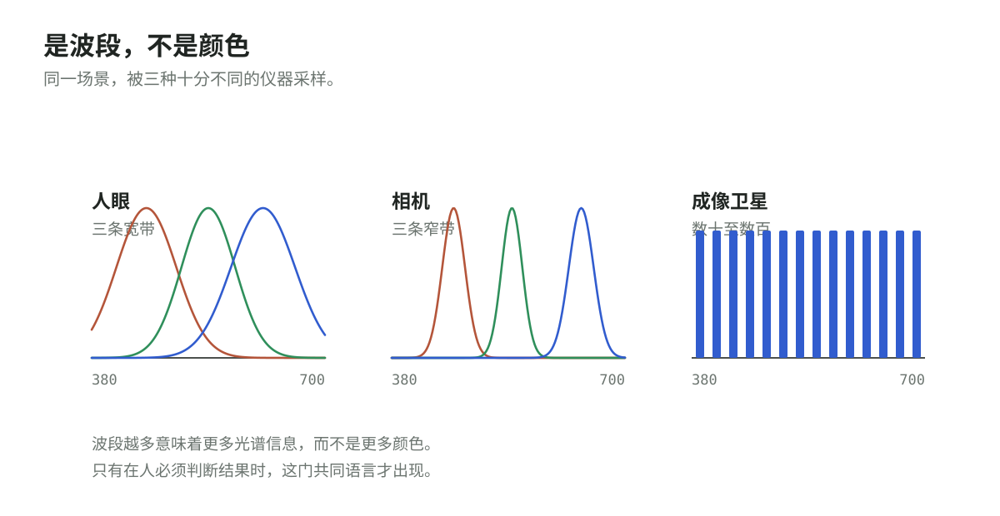

与此同时，CIELAB、OKLab 与 OKLCH 持续改进问题的"感知"一侧，尤其是在界面设计和科学可视化中，数值距离应当对应视觉距离的场合。

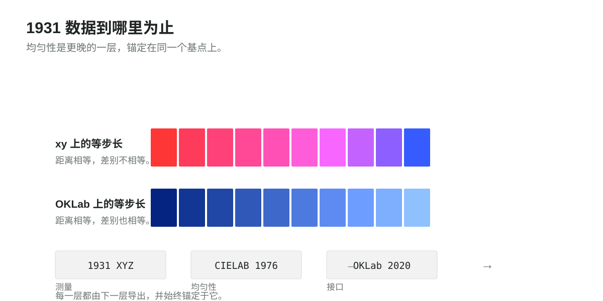

## 关于配图

本文插图为说明性示意，但曲线与马蹄形并非手绘：光谱轨迹上的每一个点、视锥响应以及色度图上的每一个颜色，都由 CIE 1931 两度配色函数按 1 纳米间隔（360–830 纳米）的表值计算得出。视锥响应通过 Hunt–Pointer–Estévez 变换从这些配色函数反推，因此图中呈现的是标准本身的数值，而不是理想化模型。色度图区域是这些坐标在 sRGB 中的渲染结果，sRGB 无法在满饱和度下呈现完整的马蹄形，所以请把颜色当作示意、把坐标当作精确值。卫星通带图里的波段中心与半高宽度依据 Sentinel-2A MSI 的公开指标，取整到整纳米；旁边那三条曲线用的仍是同一份表值。三维颜色锥在浏览器端用同一份表实时计算，表随站点一起提交（`src/data/ciexyz31_1.csv`），按 5 纳米间隔取 380 至 700 纳米；它把锥画成射线空间里的一个切片，并把马蹄形正好放在 X + Y + Z = 1 平面上，所以拖动亮度滑块只会改变点到原点的距离，不会改变它的 x 与 y。历史叙述依据 CIE 官方史料以及 Wright、Guild 的早期论文。

## 尾注：从物理世界到经验世界

这段历史容易让人联想到康德对"物自体"与"现象"的区分，但需要一处修正：电磁波是可测量的科学对象，并不等同于康德严格意义上的物自体，两者的区分并不重合。

CIE 真正建成的东西更窄、也更有用：一条从受控光谱输入到可公开比较的匹配报告的闭环。"端到端"在这里意味着闭环可以复现，而不是说有人已经解释了大脑如何产生体验。在这个意义上，客观性不是把观察者排除在外，而是严格规定观察者之间得以比较的条件。
