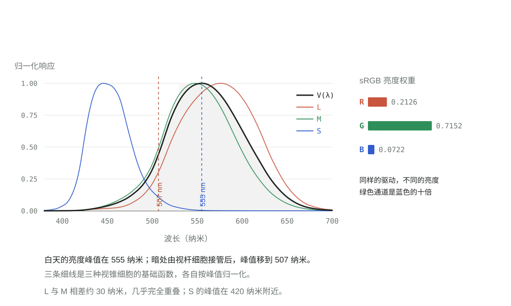
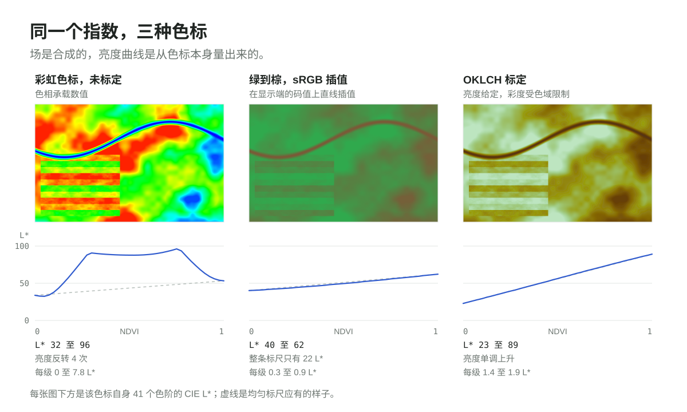

<!-- cspell:ignore CIELAB Guild JPEG MacAdam MSI NDVI OKLab OKLCH Purkinje Rec Sentinel sRGB Wright -->

手机拍下一面绿墙，照片被送到另一个大洲的屏幕上，墙还是绿的。而在两台设备之间传输的东西里，没有任何一处含有“颜色”：文件是每像素三个整数的网格，屏幕是每像素三个小灯，两台机器由不同的公司、相隔几十年、用不同的材料造出来。它们却对得上，而且几乎没有人意识到，它们必须事先说好。

这个“说好”，就是本文的主题。它是一份约定——至今仍在你口袋里运行的最古老的约定之一——由 1931 年的一个委员会写下来，而他们手头只有十七双眼睛。要走到那里，需要按顺序回答三个问题：光是什么，眼睛如何采样它，以及大家决定把什么写下来。

## 一条闭合成圆的线

可见光是电磁波；就颜色而言，唯一要紧的性质是波长：紫端约 380 纳米，红端约 700 纳米。把波长排好，得到的是一条线。

但每一个设计软件里的色轮，都把红与紫放在相邻位置，中间填上品红。品红不在这条线上——没有任何一个波长看起来是品红。

色轮不是光的图像，而是观察者的图像。把光谱两端混合，会得到光谱里根本不存在的颜色，因为眼睛根本不报告波长。它报告的是三个数，而线的两端恰好同时推高其中两个数。在这份报告里，线闭成了一个环。

## 眼睛到底测了什么

自然光的波长连续、功率连续变化。视网膜用三类视锥细胞对这个连续谱采样——细胞按自己最敏感的那一段光谱命名：长波、中波、短波敏感，记作 L、M、S。每一类的响应都覆盖很宽的一段，而且彼此高度重叠：550 纳米附近的光会同时激发三类细胞。

于是视觉系统在每个点上给出三个数，而不是一条光谱。在相同的观察条件下，能产生同一组三个数的不同光谱无法被区分——这就是同色异谱（metamerism）。它是整个领域立足的事实：颜色是光的一次多对一、有损的编码。

日常生活中随处可见。屏幕用红光加绿光造出黄色，打印机用相互叠压的油墨点造出同一种黄色，而一只熟柠檬用的是很窄的一段波长、几乎没有别的成分。三条完全不同的光谱，一组相同的三个数，同一个词。屏幕上的黄并不是柠檬的黄“差一点的副本”——就你的眼睛而言，它们就是同一种黄。

由此有两条推论，值得分开看：

1. **复制品不必对上光，只要对上报告。** 这正是三盏灯能顶替一场日落的原因，也是这次压缩“有用”而不只是“有损”的原因。
2. **报告无法反演。** 再多的颜色数据也换不回原始光谱。光谱仪测的是进入的光，色度计测的是压缩之后的输出；颜色工程活在两者之间的翻译里。

第一条是许可，第二条是限制。多数关于颜色的争论，来自把两者混为一谈。

## 眼睛在哪里敏感

三条曲线并不等于三个等价的通道，它们的差别比相似之处更要紧。有三件事常被一句话带过，值得拆开：某个波长看起来有多亮、眼睛分辨相邻波长有多细、以及它能看清多细的纹理。

**亮度不等于功率。** 在相同的物理功率下，555 纳米（黄绿）看起来比任何其他波长都亮。图中的 1924 年 V(λ) 曲线就是这个测量本身，也是标准里 Y 轴与它绑定的原因。每一套视频标准都继承了这个后果：sRGB 与 Rec. 709 使用的亮度是 `0.2126 R + 0.7152 G + 0.0722 B`，绿色承担了白色亮度的 72%，蓝色只有 7。把三个通道推到同一档，绿色看起来是蓝色的十倍亮。这个比例不是谁为了好看定的，它是从视锥曲线里掉出来的。也正因如此，同样功率的绿光笔刺眼，蓝光笔却显得暗淡；界面规范也总是劝你不要用蓝色排正文。

**入夜之后，峰值会移动。** 弱光下视杆细胞接管，眼睛的敏感度滑到约 507 纳米，这被称为浦肯野位移（Purkinje shift）。正午时花园里最亮的是红罂粟，黄昏时它近乎全黑，而蓝色的花反而更显眼。视杆色素本身的峰值更接近 498 纳米，多出来的那 9 纳米是晶状体——它先把短波吸收掉一部分，才让光到达视网膜。

**细节靠亮度传递，不靠颜色。** 眼睛分辨细密图案几乎完全依赖亮度，对颜色的分辨力要粗好几倍。这就是所有图像与视频编码都把色度降采样存储的原因：JPEG 的 4:2:0 丢掉四分之三的色度样本，没有人看得出来。短波还被聚焦在视网膜之前一点点，因为晶状体对蓝光的折射比对红光强，所以蓝色的边缘永远不够锐利。S 型视锥本身也是问题：它只占视锥总数的 5% 到 10%，而且在中央凹最中心处根本没有。蓝色是糟糕的信息载体，这也是界面指南不让你用蓝色排正文的原因。

**但绿色恰恰是这张图上最精细的地方。** 1942 年，David MacAdam 让观察者判断色度图上各处的最小可觉差，画出一圈圈椭圆：观感上相等的步长，在 x 与 y 上并不相等。最小的椭圆落在绿色与黄绿区，最大的落在蓝紫角上。在绿色附近，这张图相当于被放大了，同样的距离里塞进了更多可分辨的台阶。这是绿色轴精确的原因之一——但只是故事的一半，因为**波长**分辨力恰恰在同一区域最粗：L 与 M 在那里几乎平行上升，波长挪一点，两者的比值几乎不变。眼睛擅长分辨不同的绿色混合，却不擅长分辨相邻的绿。两句话都对，它们量的是不同的东西。

**为什么是这样，又为什么因人而异。** 脊椎动物的祖先有四类视锥。哺乳动物在恐龙时代经历了一段夜行瓶颈，丢掉了其中两类，所以狗、猫、马和牛的视觉都是二色觉：两种视锥，一个由蓝与黄构成的世界。我们这一支把第三类找了回来。大约三千万到四千万年前，旧世界猴类的长波色素基因在 X 染色体上复制了一份；两份拷贝随后各自漂移，直到峰值相隔约 30 纳米。这次意外就是红绿轴：两个色素如此相似，比较它们能得到灵敏但带噪声的信号，视网膜再用拮抗通路把它磨利。为什么保留它？主流假说是为了食物。成熟的果实和泛红的嫩叶，恰好在两种色素差异最大的 530 至 565 纳米窗口里从绿色冠层中跳出来，拿到这条轴的灵长类吃得更好。新世界猴走了另一条路：只保留一个 X 连锁基因，但让它在群体里多态，于是许多雌性是三色觉、多数雄性不是；吼猴则独立演化出了第三种视锥。

这套遗传学有一个必须写进任何设计讨论的后果。两个视蛋白基因并排躺在 X 染色体上，可以发生重组；男性只有一条 X，没有第二份可以顶替。因此约 8% 的欧洲裔男性存在某种红绿色觉缺陷，最常见的形式是色素峰值偏移而非缺失；女性的比例约为 0.5%。任何把关键区分放在红绿色相上的编码，对每十二个男性读者里的一个就是不可读的。

这正是本文余下部分反复撞上的约束。眼睛有一根精细的轴，也有一根粗糙的轴，而那根精细的轴，恰好有十二分之一的男性读者用不上。

## 1931：测量的是判断

到 1920 年代末，电光源、摄影、印刷和染料纺织共享同一个问题，而且是个生意上的问题。一城的染坊、另一城的买手、第三地的胶片：没有人能把一种颜色说成一句能活着走完全程的话。每个行业都有仪器，却没有共同语言。两家工厂可以各自都对，却仍然对不上。

| 年份      | 事件                                                                       |
| --------- | -------------------------------------------------------------------------- |
| 1900      | 国际光度委员会（CIP）成立，协调光度测量                                    |
| 1913      | 发展为国际照明委员会（CIE）                                                |
| 1924      | CIE 采用 V(λ)，即明视觉光谱光效率函数                                      |
| 1928–1930 | 伦敦的 W. D. Wright 与英国国家物理实验室的 John Guild 分别进行颜色匹配实验 |
| 1931      | CIE 公布标准观察者与 XYZ 系统                                              |

实验本身是一次零位测量——科学家说这句话的意思是：没有任何东西被直接测量。观察者一边看测试光，一边看三原色的混合，转动三个旋钮直到两半看起来一样。读数不来自表盘。观察者反复报告“相等”，在受控的适应状态下，用一个很小的中央视场：2° 视角，大约是一臂之外一片指甲的宽度。被记下来的不是光，而是一个人再也分不出两束光的那条界线。

Wright 用了 10 名观察者，原色取 630、530、460 纳米附近的窄带光。Guild 用了 7 名观察者，以滤光片得到原色，光源是钨丝灯。合计 17 人。1931 年的标准观察者就是这 17 人的平均，以 5 纳米间隔的配色函数 x̄(λ)、ȳ(λ)、z̄(λ) 列表公布。

十七个人，对一个会比在场所有人都活得久的决定来说，听起来太少，所以值得说明它为什么够用。被平均的量是原色比例，而正常色觉在人与人之间的差异，远小于当年的仪器在实验室之间的差异。样本再大一些，数字会挪一点点，形状不会变——1964 年 CIE 用更宽的样本发布补充观察者，大致就是这样的结果。

这个数字是实验样本量，不是研究团队的人数。这套标准是分层堆叠中的一层，每一层回答一个不同的问题：

| 层   | 问题                       | 学科         |
| ---- | -------------------------- | ------------ |
| 刺激 | 到达眼睛的是什么光？       | 光学、光度学 |
| 受体 | 这束光如何被采样？         | 视觉生理学   |
| 判断 | 两个刺激何时看起来相同？   | 心理物理学   |
| 变换 | 用什么不变量概括这些判断？ | 数学         |
| 接口 | 其他人可以建立在什么之上？ | 标准化       |

没有哪一层能单独产出这套标准。物理说不出两条光谱何时看起来一样，内省给不出可复现的数字，委员会也无法测量。标准之所以成立，是因为每门学科只负责一个问题，然后把结果交给下一层。

## 为什么显而易见的答案不成立

真实的原色不适合做坐标。有些饱和色根本无法靠往一侧添加三原色来匹配：观察者必须把一个原色挪到测试那一侧加上去，记下来的系数于是成了负数。没有任何物理量是负的——光是被加上去的，不是被减掉的——但一套公共坐标系承担不起这个例外。Wright 与 Guild 的数据里都有这样的值。

于是 CIE 做了一次线性基变换：选择三个虚拟原色，落在光谱轨迹之外，使所有物理可实现的刺激都有非负的 XYZ，同时让 Y 承担亮度，与 1924 年的 V(λ) 对齐。

这是最容易被忽略的一点：XYZ 没有增加数据，也没有增加物理。它只是把同一批测量换到一个约束成立、且其中一根轴已经有现成含义的基上。真正困难的工作——实验、观察者、平均——都发生在代数之前。

## 从三个数到一张图

几何在这里开始别扭，值得慢一点。标准观察者能描述的每一种颜色都是一个三元组 (X, Y, Z)，所以它们的全体住在三维空间里。它们构成一个锥体：顶点在原点，光谱色沿边缘排开——这是代数意义上的锥，而且绝不是圆的。X + Y + Z = 1 的平面截出的形状是不规则的马蹄形，因为三个虚拟原色在感知上并不同距。

<iframe
  class="viz"
  src="../../../viz/zh/"
  title="XYZ 颜色锥，三维交互视图"
  loading="lazy"
></iframe>

用指针把锥转过来，再拖动波长滑块：射线随之倾斜，圆点沿光谱移动，x 与 y 跟着改变。只拖亮度滑块时，圆点离开平面，而 x 与 y 不动——这正是“投影消去的是亮度”的意思。

归一化得到色度坐标 `x = X / (X + Y + Z)` 与 `y = Y / (X + Y + Z)`。

这是沿原点射线向 X + Y + Z = 1 平面作投影，不是“丢掉 Z”的垂直投影。x 与 y 都依赖三个值；被消去的是亮度，不是第三个坐标。只差亮度的两束光会落在同一个点上，这一步的全部目的就在于此。

马蹄形的曲边是光谱轨迹，即单色光；直边连接它的两端，代表混合色而非波长。内部覆盖了人类观察者能够匹配的全部颜色——整片领地。任何真实显示器只能够到其中一部分，那一部分就是它的色域：在这张图上，是一个以三个原色为顶点的三角形。

这张图有两种常见误读。“99% P3” 说的是 P3 的覆盖率，不是人眼可见范围：马蹄形里存在任何三原色显示都无法到达的颜色。图中面积也不具备感知均匀性：纸面上相等的距离，不等于观感上相等的差别。这两点都是地图的性质，而不是标准精度的性质。

## 这套标准没有声称的东西

1931 年的观察者不是完整的颜色理论，它也没有这样声称。

- **不是感知均匀空间。** xy 上同样大小的一步，不等于观感上同样大小的一步。CIELAB（1976），以及后来的 OKLab 与 OKLCH（2020），都是针对这一点的显式修正；它们由 1931 的数据导出，并以之为锚。
- **不是完整的外观模型。** 颜色外观会随周围环境、适应状态、亮度和刺激尺寸改变。CIECAM02 及其后继 CAM16 建模的正是这些变化，而标准观察者是它们的参考条件。
- **不解释颜色体验。** 它固定的是观察者之间可以相互比较的条件，这是一个小得多的主张。

| 主张                                 | 1931 标准是否支持        |
| ------------------------------------ | ------------------------ |
| 两个已定义的刺激对标准观察者构成匹配 | 支持，在规定的观察条件下 |
| 两种颜色相差一个给定的感知量         | 不支持，需要均匀空间     |
| 一种颜色在另一种环境中看起来相同     | 不支持，需要外观模型     |
| 看到那种颜色是什么感受               | 不支持                   |

## 从十三个波段重建一张照片

前面说的都是单个点的光。一张照片就是这些点的网格，而成像卫星把每个点的测量数又乘了上去：十三个，而不是三个。

卫星并不“拍摄”颜色。Sentinel-2 的多光谱成像仪记录 13 个波段：13 个带滤光片的探测器，每个探测器对每个像元只给出一个数——场景辐射对该滤光片响应的积分，波长从蓝端的 443 纳米一直延伸到短波红外的 2202 纳米。这些数里没有一个是“红”“绿”或“蓝”，其中还有九个在人类视觉中根本没有对应物。

必须有某个环节把 13 个积分变成 3 个。第一步是物理的：用波段自身的太阳辐照度与太阳天顶角的余弦去除，把量化值换算成反射率，于是同一块地表在正午和在轨道边缘测得一致。然后要去掉大气——路径辐射、气溶胶散射，以及按波长四次方反比增长的瑞利散射：400 纳米处比 700 纳米处大约强 9 倍。省掉这一步，用 B2 造出来的蓝通道里大部分是天空。

第二步才是本文一直在讲的那件事：把其中九个波段换算为 XYZ。这件事没有唯一解——从九个宽积分里换不回一条光谱，压缩依然有损；所谓换算，是一个 3 × 13 矩阵：让它把一批代表光谱在已知光源下映射为标准观察者会记录到的 XYZ。用实测反射率库拟合，结果取决于库；用传感器自身的响应函数拟合，结果取决于假设。两者都不是测量。

把这一步跳过，直接把三个波段的原始平均值塞进红绿蓝，得到的东西对传感器忠实、作为照片却一无是处：波段中心并不落在 sRGB 原色所在的位置，白点是太阳当天碰巧的状态，大气还留在数字里。它看上去像一张在水里泡过的卫星图。这和未标定的彩色标尺是同一种失败，只是早了一层——把一个数提拔成颜色，却没有为这项工作设计一个映射。

有一点会让初次接触这条链路的人意外：相机和卫星内部并不使用 XYZ。传感器输出的是波段值，整条处理链就留在波段空间里；去马赛克、白平衡和压缩都作用在这些数上。XYZ——以及其后的 OKLab——只在需要人来判断结果的时刻进场：在屏幕上、在报告里、在取色器里。它们是解释层，不是处理步骤；一条从不向任何人显示图像的管线，永远不需要它们。

从 XYZ 往后，都是每块屏幕早已实现好的算术：sRGB 矩阵、色域裁剪、传递函数。然后是一处编辑判断，叫色调曲线：反射率的跨度超出 8 位所能容纳的范围，于是必须由某个环节决定“什么算白”。两条管线都可以在标准上完全正确，却给出肉眼可见不同的画面。

值得留意的是，仪器最终有多少东西走到了屏幕上：13 个波段里只有 3 个变成一张真彩图；红边与红外波段被显示所丢弃，却被其他一切所保留——植被指数、水质、作物胁迫。假彩色合成则把近红外波段送进红通道，有意放弃“看起来对”，换取“差别看得见”。这正是本文开头第二条推论的主动应用：既然这次压缩不可逆，剩下的通道就该花在区分上，而不是花在还原上。

## 把一个数变成一种颜色

当这个数不再是红、绿、蓝之后，第二个问题出现了，而且它里面一点物理都没有。

NDVI 这样的指数，每像素只有一个数——近红外与红波段的归一化差值，它度量的是植被的量，不是颜色。要把它变成图像，就得发明一把标尺；而标尺本身就是仪器：读者是用眼睛判断“哪里植被更多”的，所以亮度必须随指数上升，且不许有别的东西来争夺这件事。

同一片场，同一个指数，三种映射。彩虹色标一眼好看，细看就坏：它的 CIE 亮度沿标尺反转了四次，所以一块地可以比植被更多的另一块更亮；而一旦转成灰度，或者遇到红绿色觉异常的读者，顺序就消失了。在显示端 sRGB 里把绿与棕直接插值，顺序是保住了，却只用了 100 个亮度单位里的 22 个，于是整幅图读起来都是同一个中间调，区分全部压在色相上。第三条色标写在 OKLCH 里——OKLab 的极坐标形式：给定 L，把 C 收到 sRGB 装得下为止，色相从赭石扫到绿。这时亮度只上升一次，走完 66 个单位，每一级一到两个单位。

以上没有一处动到物理。反射率、大气模型、矩阵、色调曲线都没变；差别只在于最后那一步——从数到颜色——是被当作一把感知标尺设计的，还是当作一份调色板继承下来的。

这正是前面那节关于眼睛敏感度的讨论绕回来的地方。亮度是每个读者共有的那根轴：红绿色觉缺陷的读者、把图打印成灰度的读者、白天把手机亮度调低的读者。色相不是。把顺序放进亮度不是审美偏好；它是唯一能在图像被复制、打印、缩放之后仍然活下来的通道。

## 几乎每一步都是选择

几乎每一步都是选择：大气模型、用来拟合矩阵的光谱库、色域策略、色调曲线、把指数送到屏幕上的那条色标，每一个背后都有一堆互相不一致的文献。唯一不算选择的，是 XYZ 以及它所指向的那个观察者的定义；而它恰好也是仪器换代时谁都不必重新谈判的那一个。卫星注定是临时的，它所校准的那个观察者，已经送走了四代探测器。

## 一个可以迁移的设计判断

先把颜色放一边，因为这里耐久的教训关于接口，而不是关于光。

这套标准之所以耐久，靠的是抽象的尺寸，而不是实验的精度。1931 年的观察者已知并不完美：1964 年补充观察者把视场扩大到 10°，锥体基础函数后来由这批数据反推得到，V(λ) 在蓝端至今仍有讨论。

这些都没有让接口退役。而接口本来可以是别的东西。委员会完全可以标准化一台仪器、一张色卡、一套颜料，或者一个观察箱——都很具体，都有用，也都会在十年内过时。它标准化的是一个函数：三条曲线加一次变换，任何人都能从中导出仪器、色卡和色域图。

这也是值得用在内部分界线上的检验。不是“十年后它是否仍然成立”——大概不会。而是“当底下的事实变了，建立在它之上的东西还能不能被表达”。配色函数位于显示器、传感器和色彩空间之下，所以它们中的任何一个都可以被替换，而不必重新协商标准。

同一套推理也解释了那些看起来别扭的部分：没人能制造出来的虚拟原色、非负坐标、被“征用”来表示亮度的 Y。每一处都是为了让上层好用而做的主动让步。下游接口简单，通常意味着复杂度被有意识地在上游吸收了。

## 95 年后

今天每一块手机屏幕、每一条相机管线、每一个印刷配置文件和每一次 HDR 母版制作，仍然在讲 XYZ。传感器可以捕获 4 个波段，也可以捕获上百个，内部完全不需要它；但当结果需要人来判断时，这门共同语言就挣回了成本。

与此同时，CIELAB、OKLab 与 OKLCH 持续改进问题的“感知”一侧，尤其是在界面设计和科学可视化中，数值距离应当对应视觉距离的场合。

## 关于配图

本文插图为说明性示意，但曲线与马蹄形并非手绘：光谱轨迹上的每一个点、视锥响应以及色度图上的每一个颜色，都由 CIE 1931 两度配色函数按 1 纳米间隔（360–830 纳米）的表值计算得出。视锥响应通过 Hunt–Pointer–Estévez 变换从这些配色函数反推，因此图中呈现的是标准本身的数值，而不是理想化模型。眼睛敏感度那张图用的还是同一份表：V(λ) 就是 ȳ(λ) 本身，555 纳米的标记落在表中的最大值上，三条细线则是按各自峰值归一的视锥基础函数；旁边的权重是公开的 Rec. 709 亮度系数，507 纳米的标记是 CIE 1951 暗视觉峰值，而不是这里自己编的一条曲线。色度图区域是这些坐标在 sRGB 中的渲染结果，sRGB 无法在满饱和度下呈现完整的马蹄形，所以请把颜色当作示意、把坐标当作精确值。卫星通带图里的波段中心与半高宽度依据 Sentinel-2A MSI 的公开指标，取整到整纳米；旁边那三条曲线用的仍是同一份表值。色标对比图比较的是映射，而不是数据：指数场是合成的，按生长季农田场景的分布生成；三条色标以及图下的 L\* 曲线则全部是算出来的——彩虹用 HSV，显示端 sRGB 用直线插值，OKLCH 用 Björn Ottosson 的 OKLab 矩阵，并在每一级收彩度直到落进 sRGB 为止。每个 L\* 都是实际绘制出的那组字节按 CIE 1976 亮度的换算值。三维颜色锥在浏览器端用同一份表实时计算，表随站点一起提交（`src/data/ciexyz31_1.csv`），按 5 纳米间隔取 380 至 700 纳米；它把锥画成射线空间里的一个切片，并把马蹄形正好放在 X + Y + Z = 1 平面上，所以拖动亮度滑块只会改变点到原点的距离，不会改变它的 x 与 y。历史叙述依据 CIE 官方史料以及 Wright、Guild 的早期论文。

## 尾注：从物理世界到经验世界

这段历史容易让人联想到康德对“物自体”与“现象”的区分，但需要一处修正：电磁波是可测量的科学对象，并不等同于康德严格意义上的物自体，两者的区分并不重合。

CIE 真正建成的东西更窄、也更有用：一条从受控光谱输入到可公开比较的匹配报告的闭环。“端到端”在这里意味着闭环可以复现，而不是说有人已经解释了大脑如何产生体验。在这个意义上，客观性不是把观察者排除在外，而是严格规定观察者之间得以比较的条件。
